# Simulado Grafos — Resolução

## Questão 1 ✓

- Um grafo `G = (V, E)` é formado por um conjunto de **vértices** `V` e um
  conjunto de **arestas** `E`, onde cada aresta liga dois vértices
  (suas extremidades), ex.: `e1 = {v1, v3}`.

V = {v1, v2, v3, v4, v5, v6, v7, v8, v9, v10, v11} e
E = {e1, e2, e3, e4, e5, e6, e7, e8, e9, e10, e11, e12, e13, e14, e15}

## Questão 2 ✓

- Arestas paralelas: duas (ou mais) arestas com os mesmos vértices-extremidades.
  Considerando o grafo G, não há arestas paralelas.

## Questão 3 ✓

- Vértice isolado: não é extremidade de nenhuma aresta (grau 0).
  Considerando o grafo G, não há vértices isolados, pois todos têm grau ≥ 2.

## Questão 4 ✓

- Conjunto vizinhança `N(v)`: todos os vizinhos de `v`.
  N(v6) = {v5, v8, v9, v11}
  N(v9) = {v6, v8, v10, v11}

## Questão 5 ✓

- "Grafo simples" é sobre a ausência de laços/paralelas.
  Como G não possui laços nem arestas paralelas, G é simples.

## Questão 6 ✓

- Grau `deg(v)`: número de arestas incidentes em `v` (um laço conta 2).

deg(v1) = 2
deg(v2) = 2
deg(v3) = 3
deg(v4) = 2
deg(v5) = 3
deg(v6) = 4
deg(v7) = 2
deg(v8) = 4
deg(v9) = 4
deg(v10) = 2
deg(v11) = 2

## Questão 7 ✓

- Sequência de graus: lista com os graus (números) de todos os vértices,
  geralmente em ordem não crescente, ex.: `(4, 3, 3, 2)`.

  Sequência de graus de G = (4, 4, 4, 3, 3, 2, 2, 2, 2, 2, 2)

## Questão 8 ✓

`G` é k-regular se todo vértice tem grau `k`.
G não é regular, pois possui vértices com graus diferentes
(ex.: deg(v1) = 2 ≠ deg(v6) = 4).

## Questão 9

- Grafo **cúbico**: grafo 3-regular (todo vértice tem grau 3).

**G1 = K4** (4 vértices, 6 arestas, todos os vértices com grau 3):

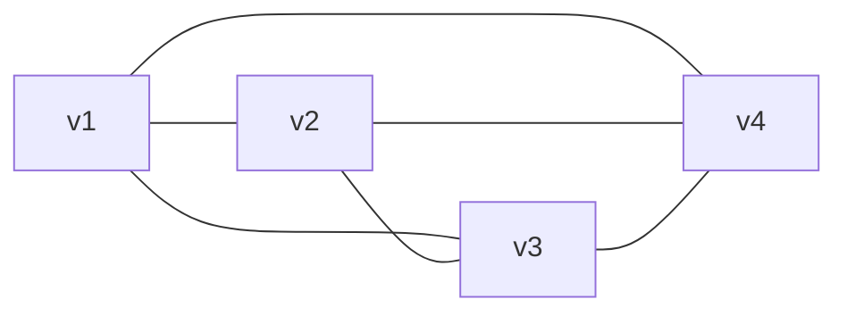

**G2 = K3,3** (6 vértices, 9 arestas, todos os vértices com grau 3):

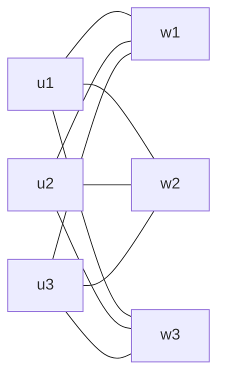

## Questão 10

- **Lema do aperto de mãos**: `Σ deg(v) = 2·|E|`. Logo a soma dos graus é
  sempre **par** (e o número de vértices de grau ímpar também é par).
- Em um grafo simples com `n` vértices, o grau máximo é `n − 1`.

## Questão 11

- Mesmo raciocínio da questão 10: a soma dos graus precisa ser par
  (`Σ deg(v) = 2·|E|`) e `deg(v) ≤ n − 1`.

## Questão 12

- **Grafo de intersecção**: um vértice para cada conjunto `Ai`; existe aresta
  entre `Ai` e `Aj` (i ≠ j) se e somente se `Ai ∩ Aj ≠ ∅`.

| Par | Intersecção | Aresta? |
|---|---|---|
| A1, A2 | {0, 2, 4} | sim |
| A1, A3 | ∅ | não |
| A1, A4 | {6, 8} | sim |
| A1, A5 | {0, 8} | sim |
| A2, A3 | {1, 3} | sim |
| A2, A4 | ∅ | não |
| A2, A5 | {0, 1} | sim |
| A3, A4 | {5, 7, 9} | sim |
| A3, A5 | {1, 9} | sim |
| A4, A5 | {8, 9} | sim |

V = {A1, A2, A3, A4, A5}
E = {A1A2, A1A4, A1A5, A2A3, A2A5, A3A4, A3A5, A4A5} (8 arestas)

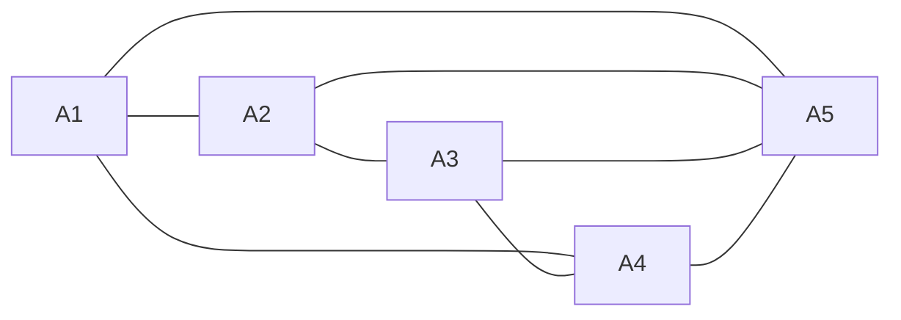

## Questão 13

- Ver definição de isomorfismo na questão 15. Se dois grafos são isomorfos,
  eles têm obrigatoriamente o **mesmo número de vértices**.

## Questão 14

- Ver definição de isomorfismo na questão 15. Se dois grafos são isomorfos,
  eles têm obrigatoriamente o **mesmo número de arestas**.

## Questão 15 ✓

`G1=(V1,E1)` e `G2=(V2,E2)` são **isomorfos** se existem bijeções
`f: V1→V2` e `g: E1→E2` que preservam a incidência (a aresta `g(e)` liga
`f(u)` e `f(v)` sempre que `e` ligava `u` e `v`).

**Invariantes** (se G1≅G2, então G1 e G2 têm que ter): o mesmo número de
vértices, o mesmo número de arestas, e a mesma sequência de graus (mesmo
número de vértices de cada grau).

> Para **provar que NÃO são isomorfos** basta achar 1 invariante diferente.
> Para provar que **são** isomorfos, é preciso exibir as funções f e g.

V1 = {v1, v2, v3, v4, v5, v6}, |E1| = 10
deg(v1) = 3
deg(v2) = 4
deg(v3) = 4
deg(v4) = 3
deg(v5) = 2
deg(v6) = 4
Sequência de graus: (4, 4, 4, 3, 3, 2)

V2 = {v1, v2, v3, v4, v5, v6}, |E2| = 10
deg(v1) = 2
deg(v2) = 4
deg(v3) = 4
deg(v4) = 4
deg(v5) = 4
deg(v6) = 2
Sequência de graus: (4, 4, 4, 4, 2, 2)

G1 e G2 têm o mesmo número de vértices (6) e de arestas (10), mas sequências de graus diferentes. Como a sequência de graus é um invariante, G1 e G2 não são isomorfos.

## Questão 16

- **Grafo completo `Kn`**: grafo simples com `n` vértices em que todo par de
  vértices distintos é ligado por uma aresta.
  Número de arestas: `|E| = n(n − 1) / 2` (= C(n, 2), número de pares).

## Questão 17

- Ver questão 16: `|E(Kn)| = n(n − 1) / 2`.

## Questão 18

- **Grafo bipartido completo `Km,n`**: vértices divididos em dois grupos
  `X` (com `m` vértices) e `Y` (com `n` vértices); **cada** vértice de `X` é
  ligado a **todos** os de `Y`, e não há arestas dentro do mesmo grupo.

X = {x1, x2, x3}, Y = {y1, y2, y3, y4, y5} → 3 + 5 = 8 vértices e 3 · 5 = 15 arestas.

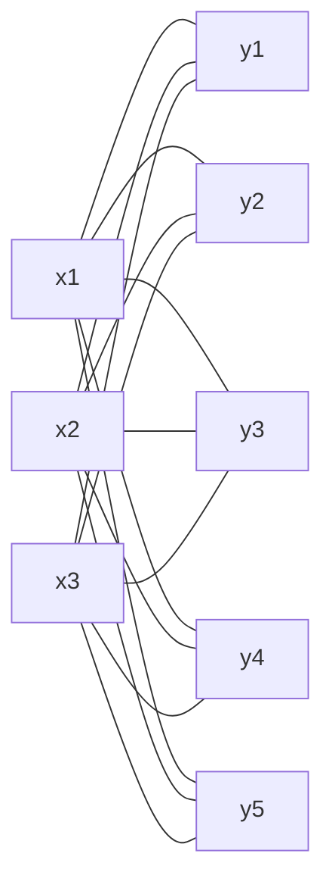

## Questão 19

- Ver questão 18 (`Km,n`).

X = {x1, x2, x3}, Y = {y1, y2, y3, y4} → 3 + 4 = 7 vértices e 3 · 4 = 12 arestas.

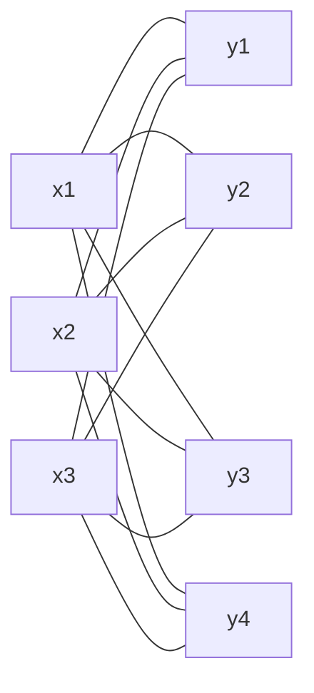

## Questão 20

- `V` pode ser particionado em dois conjuntos não vazios e disjuntos
  `X` e `Y` (`X ∪ Y = V`, `X ∩ Y = ∅`) tais que toda aresta tem uma
  extremidade em `X` e a outra em `Y` (nunca liga dois vértices do mesmo
  lado). Um grafo é bipartido se e somente se não tem ciclo de tamanho ímpar.

## Questão 21

> Obs.: o enunciado diz "questão 21", mas se refere ao grafo G da questão 20.

- **Supergrafo**: `G' = (V', E')` é supergrafo de `G = (V, E)` se `V ⊆ V'` e
  `E ⊆ E'` (ou seja, G está contido em G'; G' tem tudo de G e pode ter mais).

G = (V, E), com V = {v1, v2, v3, v4, v5} e E = {v1v2, v1v4, v3v4, v4v5}.

Supergrafo G' = (V', E'), adicionando o vértice v6 e as arestas v2v3 e v5v6:

- V' = {v1, v2, v3, v4, v5, v6}
- E' = {v1v2, v1v4, v3v4, v4v5, v2v3, v5v6}

Como V ⊆ V' e E ⊆ E', G' é supergrafo de G.

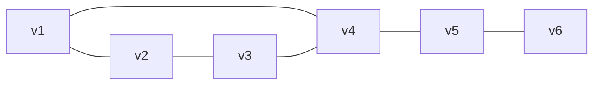

## Questão 22

> Obs.: o grafo G é o da questão 20.

- **Subgrafo**: `H = (V', E')` é subgrafo de `G = (V, E)` se `V' ⊆ V` e
  `E' ⊆ E`, e toda aresta de `E'` tem as duas extremidades em `V'`.

Subgrafo H = (V', E'), mantendo só v1, v2 e v4:

- V' = {v1, v2, v4}
- E' = {v1v2, v1v4}

Como V' ⊆ V, E' ⊆ E e as arestas de E' têm as extremidades em V', H é subgrafo de G.

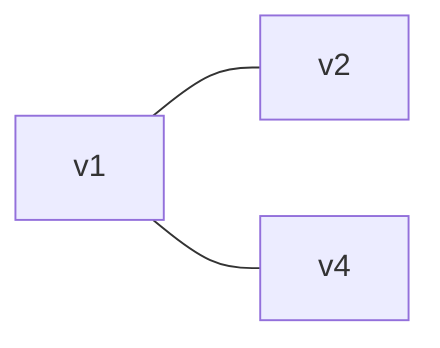

## Questão 23

- **Passeio**: sequência alternada vértice–aresta–vértice… (pode repetir
  vértices e arestas). **Aberto**: começa e termina em vértices diferentes;
  **fechado**: começa e termina no mesmo vértice.
- **Trilha**: passeio **sem repetir arestas** (vértices podem repetir).
- **Circuito**: trilha fechada (sem repetir arestas, volta ao início).
- **Caminho**: passeio **sem repetir vértices** (logo, nem arestas).
- **Ciclo**: caminho fechado (só o vértice inicial = final se repete).
  Um laço (aresta de um vértice nele mesmo) já forma um ciclo.

## Questão 24

- **Grafo Euleriano**: possui um **circuito Euleriano** (circuito que passa
  por **todas as arestas** exatamente uma vez).
- **Teorema de Euler**: um grafo conexo é Euleriano ⇔ **todos** os vértices
  têm **grau par**.
- (Se exatamente 2 vértices têm grau ímpar, há uma **trilha** Euleriana
  entre eles, mas o grafo não é Euleriano.)

## Questão 25

- Ver questão 24 (Teorema de Euler: conexo + todos os graus pares).

## Questão 26

- Ver questão 24 (Teorema de Euler: conexo + todos os graus pares).

## Questão 27

- Ver questão 24 (Teorema de Euler: conexo + todos os graus pares).

## Questão 28

- **Grafo Hamiltoniano**: possui um **ciclo Hamiltoniano** (ciclo que passa
  por **todos os vértices** exatamente uma vez e volta ao início).
- Não há um critério simples como o de Euler; normalmente se **exibe** o
  ciclo, ou se usa Dirac/Ore (questões 45 e 46).

## Questão 29

- Ver questão 16: `Kn` tem `n` vértices e `n(n − 1) / 2` arestas.

## Questão 30

- `Km,n` (questão 18): tem `m + n` vértices e `m · n` arestas
  (cada um dos `m` vértices liga-se aos `n` do outro lado).

## Questão 31

- **Ciclo `Cn`** (n ≥ 3): `n` vértices `v1, v2, …, vn` ligados em anel
  (`v1–v2, v2–v3, …, vn–v1`). Tem `n` vértices e `n` arestas.

## Questão 32

- **Cubo `Qn`**: vértices são as sequências binárias de `n` bits; dois
  vértices são adjacentes se diferem em **exatamente 1 bit**.
  Tem `2ⁿ` vértices; cada vértice tem grau `n`, logo
  `|E| = n · 2ⁿ / 2 = n · 2ⁿ⁻¹` arestas.

## Questão 33

- **Roda `Wn`**: um ciclo `Cn` + **1 vértice central** ligado a todos os `n`
  vértices do ciclo. Tem `n + 1` vértices e `2n` arestas
  (`n` do ciclo + `n` "raios").

## Questão 34

- **Lema do aperto de mãos**: `Σ deg(v) = 2·|E|` → `|E| = Σ deg(v) / 2`.
- Se o grafo não precisa ser simples, pode usar laços/arestas paralelas para
  desenhar.

|E| = (5 + 2 + 2 + 2 + 2 + 1) / 2 = 14 / 2 = **7 arestas**.

É possível até como grafo simples (6 vértices, grau máximo 5 = n − 1):
v1 ligado a todos os outros (grau 5), mais as arestas v2v3 e v4v5.

deg(v1) = 5, deg(v2) = deg(v3) = deg(v4) = deg(v5) = 2, deg(v6) = 1.

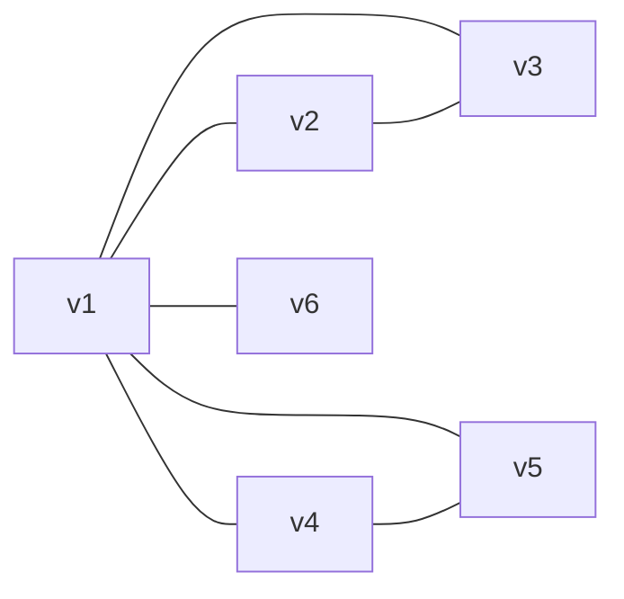

## Questão 35

- Condições necessárias para um grafo **simples** com `n` vértices:
  1. A soma dos graus é **par** (aperto de mãos).
  2. Nenhum grau passa de `n − 1`.
- Para confirmar, **tente desenhar** (ou use Havel-Hakimi: remove o vértice
  de maior grau `d`, subtrai 1 dos `d` próximos maiores graus, repete;
  se chegar a tudo zero, existe).

**Existe.** Soma = 3 + 3 + 3 + 3 + 2 = 14 (par) → 7 arestas; grau máximo 3 ≤ 4.

Construção: parte-se de K4 (v1..v4, todos com grau 3), remove-se a aresta v1v2
e liga-se v5 a v1 e a v2.

E = {v1v3, v1v4, v2v3, v2v4, v3v4, v1v5, v2v5}
deg(v1) = deg(v2) = deg(v3) = deg(v4) = 3, deg(v5) = 2.

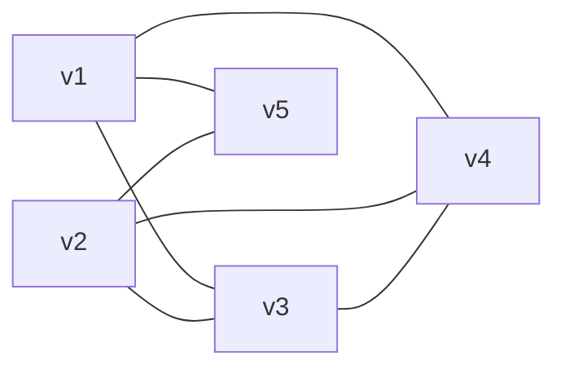

## Questão 36

- Ver questão 35 (soma par, grau ≤ n − 1, tentar desenhar).

**Não existe.**

- A soma dos graus é 1 + 2 + 3 + 4 + 5 = 15, que é **ímpar**, contrariando
  `Σ deg(v) = 2·|E|`.
- Além disso, em um grafo simples com 5 vértices o grau máximo é 4, e há um
  vértice com grau 5.

## Questão 37

- Ver questão 35 (soma par, grau ≤ n − 1, tentar desenhar).
- Dica: se um vértice tem grau `n − 1`, ele é vizinho de **todos** os outros,
  então nenhum outro vértice pode ter grau 0.

**Não existe.** A soma é 14 (par) e o grau máximo é 4 ≤ n − 1, mas há **dois**
vértices de grau 4 = n − 1. Cada um deles é vizinho de todos os outros, então
todo vértice restante tem grau ≥ 2. Isso contradiz a existência de um vértice
de grau 1.

## Questão 38

- Ver questão 35 (soma par, grau ≤ n − 1, tentar desenhar).

**Não existe.** A soma dos graus é 3 + 4 + 3 + 4 + 3 = 17, que é **ímpar**,
contrariando `Σ deg(v) = 2·|E|`.

## Questão 39

- **Subgrafo** (questão 22): escolha um subconjunto **não vazio** de vértices
  e, depois, um subconjunto das arestas que têm **as duas extremidades**
  entre os vértices escolhidos. Conte todas as combinações possíveis.

## Questão 40

- Ver questões 22 e 39. Organize por número de vértices (1, 2, 3, 4) e,
  para cada escolha de vértices, liste todas as escolhas de arestas válidas.

G: V = {a, b, c, d}, E = {ab, ac, ad}. Todas as arestas usam o vértice `a`,
então só há arestas no subgrafo se `a` estiver em V'.

**1 vértice** (4 subgrafos, sem arestas):
{a}, {b}, {c}, {d}

**2 vértices** (6 + 3 = 9 subgrafos):
- Sem arestas: {a,b}, {a,c}, {a,d}, {b,c}, {b,d}, {c,d}
- Com aresta: {a,b} + ab, {a,c} + ac, {a,d} + ad

**3 vértices** (4 + 4 + 4 + 1 = 13 subgrafos):
- {b,c,d}: só sem arestas (1)
- {a,b,c}: ∅, {ab}, {ac}, {ab,ac} (4)
- {a,b,d}: ∅, {ab}, {ad}, {ab,ad} (4)
- {a,c,d}: ∅, {ac}, {ad}, {ac,ad} (4)

**4 vértices** {a,b,c,d} (8 subgrafos):
∅, {ab}, {ac}, {ad}, {ab,ac}, {ab,ad}, {ac,ad}, {ab,ac,ad}

Total: 4 + 9 + 13 + 8 = **34 subgrafos**.

Exemplos desenhados (4 vértices):

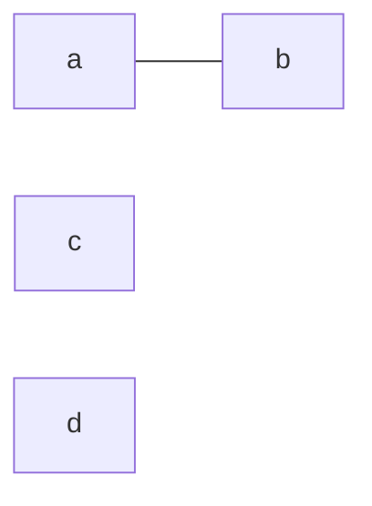

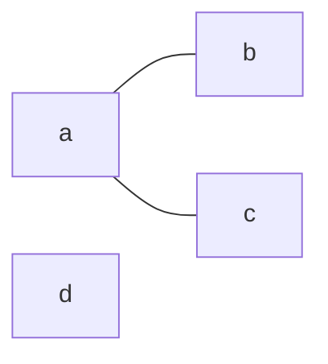

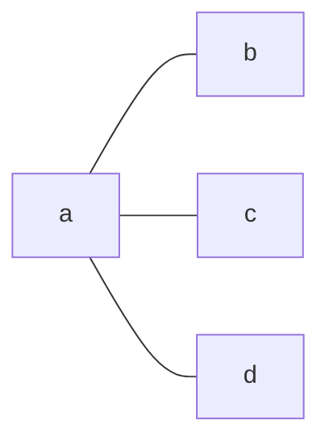

## Questão 41

- Grafo **k-regular**: todo vértice tem grau `k` (questão 8).
- Em `Kn`, cada vértice é ligado a todos os outros `n − 1` vértices.

## Questão 42

- Grafo **k-regular**: todo vértice tem grau `k`.
- Em `Cn` (n ≥ 3), cada vértice tem exatamente 2 vizinhos no anel.

## Questão 43

- Grafo **k-regular**: todo vértice tem grau `k`.
- Em `Wn` (n ≥ 3), compare o grau do vértice **central** (`n`) com o grau dos
  vértices do **ciclo** (2 do ciclo + 1 do raio).

## Questão 44

- Grafo **k-regular**: todo vértice tem grau `k`.
- Em `Qn`, cada vértice tem como vizinhos as sequências que diferem em 1 bit
  (há `n` bits para trocar).

## Questão 45

- **Teorema de Dirac**: se `G` é simples com `n ≥ 3` vértices e
  `deg(v) ≥ n/2` para **todo** vértice `v`, então `G` é Hamiltoniano.
- **Condição suficiente**: se vale, garante o resultado (mas o resultado
  pode ocorrer sem ela).
- **Condição necessária**: se o resultado ocorre, ela tem que valer.
- Dica: pense em `Cn` com n grande (é Hamiltoniano? satisfaz Dirac?).

## Questão 46

- **Teorema de Ore**: se `G` é simples com `n ≥ 3` vértices e
  `deg(u) + deg(v) ≥ n` para **todo par de vértices não adjacentes** `u, v`,
  então `G` é Hamiltoniano.
- Ver na questão 45 a diferença entre suficiente e necessária.

## Questão 47 ✓

- **Hamiltoniano**: ciclo passando por todos os vértices uma vez (questão 28).
  Dica: um vértice de **grau 1** não pode estar em nenhum ciclo.
- **Euleriano**: conexo e todos os graus pares (questão 24).

Graus: deg(v1) = 3, deg(v2) = 3, deg(v3) = 3, deg(v4) = 2, deg(v5) = 1.

- **Não é Hamiltoniano**: v5 tem grau 1 (só é ligado a v2), então não pode
  pertencer a nenhum ciclo — um ciclo exige que cada vértice tenha 2 arestas
  no ciclo (uma para entrar e outra para sair).
- **Não é Euleriano**: pelo Teorema de Euler, todos os vértices precisariam
  ter grau par, mas v1, v2, v3 e v5 têm grau ímpar.

## Questão 48

- **Classe P**: problemas de decisão que podem ser **resolvidos** em tempo
  polinomial (`O(nᵏ)`) por um algoritmo determinístico.
- **Classe NP**: problemas cuja solução pode ser **verificada** em tempo
  polinomial (dado um "certificado").
- **NP-Completo**: problema que está em NP **e** é NP-difícil (todo problema
  de NP pode ser reduzido a ele em tempo polinomial). Ex.: ciclo
  Hamiltoniano, caixeiro viajante (decisão), SAT.

## Questão 49

- **Emparelhamento (matching)** `M`: conjunto de arestas sem vértices em
  comum. **Máximo**: com o maior número possível de arestas.
- **Caminho M-alternante**: caminho cujas arestas alternam entre fora de `M`
  e dentro de `M`. **M-aumentante**: caminho alternante que começa e termina
  em vértices **não cobertos** por `M`.
- **Teorema de Berge (1957)**: `M` é máximo ⇔ não existe caminho
  M-aumentante em `G`.

## Questão 50

- **Teorema de Hall (casamento)**: seja `G` bipartido com partes `X` e `Y`.
  Existe um emparelhamento que **cobre todo `X`** ⇔ para todo subconjunto
  `S ⊆ X`, `|N(S)| ≥ |S|` (condição de Hall), onde `N(S)` é o conjunto dos
  vizinhos dos vértices de `S`.
